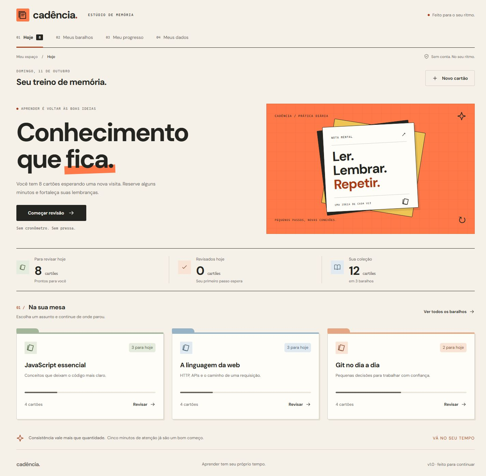
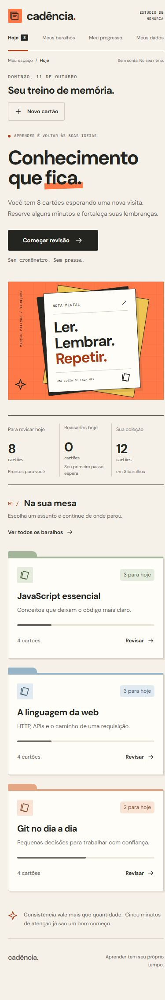

# Cadência

**Um pouco hoje. Mais fácil amanhã.**

Cadência é um aplicativo de cartões de estudo para organizar assuntos, praticar recordação e distribuir revisões ao longo dos dias. Foi criado como projeto de estudo e portfólio com **Svelte 5, TypeScript 6 e IndexedDB**, explorando uma interface reativa e persistência local sem servidor de aplicação.

A identidade visual combina papel creme, tinta escura e laranja, com navegação no topo, tipografia sem serifa e baralhos em forma de fichas. A interface se adapta a celular, tablet e desktop; as fontes são servidas junto do aplicativo.



[Abrir o aplicativo](https://fbottega-dev.github.io/cadencia/) · [Repositório](https://github.com/fbottega-dev/cadencia) · [Guia de estudo](docs/GUIA-DE-ESTUDO.md) · [Validação](docs/VALIDACAO.md) · [Próximos passos](docs/EVOLUCAO.md)

## O que você pode fazer

- Ver os cartões previstos para hoje e os que estão atrasados.
- Criar, editar e excluir baralhos com nome, descrição e cor.
- Criar e editar cartões com pergunta na frente e resposta no verso; buscar conteúdo para encontrar um cartão.
- Estudar em uma sessão, revelar a resposta e avaliar a própria recordação.
- Consultar o progresso semanal gerado pelas revisões realmente feitas.
- Exportar um backup JSON e importá-lo em outro navegador.
- Usar a versão de produção offline depois do primeiro carregamento e da instalação do service worker.

O primeiro acesso começa com **3 baralhos e 12 cartões de exemplo**. O histórico começa vazio: o aplicativo não apresenta revisões fictícias como atividade do usuário.

<details>
<summary>Ver a interface em celular</summary>



</details>

## Executar localmente

Pré-requisito: **Node.js 24 ou superior**, com npm.

```bash
git clone https://github.com/fbottega-dev/cadencia.git
cd cadencia
npm ci
npm run dev
```

Abra o endereço exibido pelo Vite no terminal. Para verificar o projeto e servir a compilação de produção:

```bash
npm run check
npm test
npm run build
npm run preview
```

| Comando           | Finalidade                                        |
| ----------------- | ------------------------------------------------- |
| `npm ci`          | Instalar as versões registradas no lockfile       |
| `npm run dev`     | Iniciar o ambiente de desenvolvimento             |
| `npm run check`   | Verificar tipos e componentes Svelte              |
| `npm test`        | Executar os testes automatizados uma vez          |
| `npm run build`   | Gerar os arquivos estáticos em `dist/`            |
| `npm run preview` | Servir `dist/` para conferir a versão de produção |

O service worker é registrado apenas na versão de produção. Para verificar o uso offline, abra o endereço de `npm run preview` com conexão, aguarde a instalação do worker, recarregue e então teste sem rede. Abrir `index.html` diretamente pelo sistema de arquivos não substitui um servidor HTTP.

## Como uma revisão é agendada

Cada cartão ocupa uma caixa de **0 a 5**. As caixas representam intervalos de **0, 1, 3, 7, 14 e 30 dias**. Depois de revelar a resposta, a avaliação determina a nova caixa:

| Avaliação               | Mudança                        | Próxima revisão                    |
| ----------------------- | ------------------------------ | ---------------------------------- |
| Preciso rever (`again`) | Volta à caixa 0                | Amanhã                             |
| Lembrei (`good`)        | Avança 1 caixa, até a caixa 5  | Conforme o intervalo da nova caixa |
| Com facilidade (`easy`) | Avança 2 caixas, até a caixa 5 | Conforme o intervalo da nova caixa |

Um cartão novo na caixa 0 pode ser estudado hoje. Depois de qualquer avaliação, ele sai da fila do dia; inclusive “Preciso rever” retorna apenas no dia seguinte. Por exemplo, um cartão novo avaliado como “Lembrei” volta amanhã; como “Com facilidade”, volta em três dias.

As datas seguem o **calendário local do dispositivo**. Este é um modelo pedagógico inspirado em Leitner, com regras deliberadamente simples. Não implementa FSRS nem SM-2 e não promete um ganho específico de aprendizagem.

## Seus dados

Baralhos, cartões e revisões são salvos em **IndexedDB no navegador**, sem login, sincronização, banco de dados no servidor ou analytics do aplicativo. As fontes fazem parte do pacote do site.

O armazenamento pertence à origem do site e ao perfil do navegador. Trocar de navegador, dispositivo, domínio ou porta local não transfere os dados. Apagar os dados do site pode apagá-los; a disponibilidade e a permanência do armazenamento também dependem do navegador. **Mantenha backups JSON para preservar e transportar seu acervo.**

Importar um backup **substitui a coleção atual após confirmação**. O arquivo passa por validação de estrutura, relações e limites antes da gravação. Exporte a coleção atual antes de trocar por outra. Os limites são 100 baralhos, 5.000 cartões e 20.000 revisões. A coleção serializada e os arquivos de backup têm um limite de 2 MiB (2.097.152 bytes); conteúdos longos podem atingir esse limite antes do número máximo de itens.

Se duas abas tentarem salvar versões diferentes da coleção, uma revisão otimista detecta o conflito para evitar sobrescrever silenciosamente a gravação mais recente. Isso não é sincronização entre dispositivos nem mesclagem automática de alterações.

O service worker guarda arquivos da aplicação para o acesso offline. Esse cache e o banco de dados têm funções diferentes: **cache não é backup dos cartões**. No primeiro acesso, ainda é necessário carregar os arquivos pela rede.

## Decisões técnicas

| Tecnologia     | Papel no projeto                                 |
| -------------- | ------------------------------------------------ |
| Svelte 5       | Componentes e estado reativo com runes           |
| TypeScript 6   | Contratos entre interface, regras e persistência |
| Vite 8         | Desenvolvimento e geração do site estático       |
| IndexedDB      | Persistência assíncrona no navegador             |
| Service worker | Cache dos arquivos necessários ao uso offline    |
| Vitest 5       | Testes das regras e da persistência              |

As regras de revisão ficam em funções puras, separadas da interface. A entrada de arquivos e a leitura do armazenamento têm validação em tempo de execução: os tipos do TypeScript não tornam um JSON externo confiável. O [guia de estudo](docs/GUIA-DE-ESTUDO.md) mostra por onde começar a ler o código.

## Publicação

A demonstração está publicada em [fbottega-dev.github.io/cadencia](https://fbottega-dev.github.io/cadencia/). A CI verifica tipos, testes e build em Windows e Ubuntu antes de publicar. Consulte as evidências e limites em [Validação](docs/VALIDACAO.md).

## Contexto do projeto

Este projeto foi desenvolvido **com apoio de IA como exercício de estudo e portfólio**. A documentação registra escolhas, limites e formas de reproduzir as verificações; não representa uma alegação de implementação inteiramente manual ou de experiência profissional prévia com a stack. O objetivo é permitir estudar, explicar e evoluir cada parte do aplicativo.
